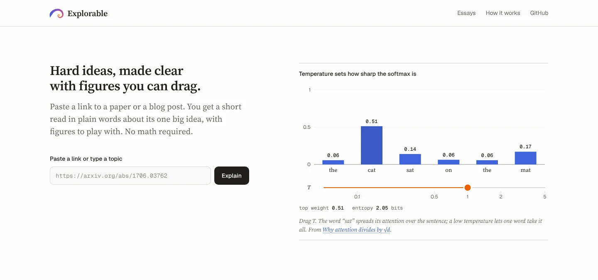
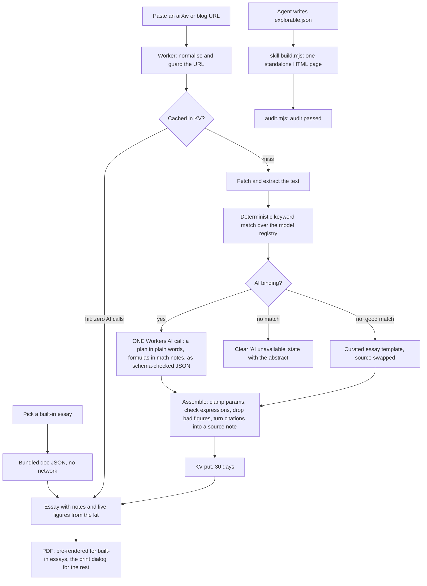

#  Explorable

**Hard ideas, made clear with figures you can drag.**

Paste a link to a paper or a blog post. You get a short read in plain words about its one big idea, with figures to play with. No math required.



**Live demo: https://explorable.geekplux.com**

The built-in essays open instantly and work offline, with no account and no key. A new link costs at most one AI call, and every number on a figure comes from a tested model of the idea.

## Quick start

**1. Try it in the browser.** Open [the live demo](https://explorable.geekplux.com), pick *Why attention divides by √d* and drag the orange handle. Press the Σ after a sentence to see the formula behind it, or the PDF button to take the essay with you.

**2. Run it locally.** You need [pnpm](https://pnpm.io) 9; pnpm fetches the pinned Node 22 itself.

```sh
git clone https://github.com/geekplux/explorable && cd explorable
pnpm i && pnpm dev
```

Open the URL Vite prints. The built-in essays work offline. A pasted link works too: without an AI binding it reuses a matching essay or says plainly that AI is unavailable.

**3. Give your coding agent the skill.** One command installs the `/explorable` skill and builds an example page (Node 20.10+, nothing else):

```sh
npx degit geekplux/explorable/skills/explorable ~/.claude/skills/explorable && \
node ~/.claude/skills/explorable/scripts/build.mjs ~/.claude/skills/explorable/examples/bloom-filter/explorable.json
```

From a clone, copy it instead: `mkdir -p ~/.claude/skills && cp -r skills/explorable ~/.claude/skills/explorable`, then run the same `node …/build.mjs` line. Open `~/.claude/skills/explorable/examples/bloom-filter/index.html` and drag. Then in Claude Code ask `/explorable explain how a Bloom filter trades memory for false positives`. More in the [skill's README](skills/explorable/README.md).

## Why

You finish an abstract and feel you could follow it if you could poke at it. Bartosz Ciechanowski and Amelia Wattenberger showed how good that can be, but each of their essays takes weeks to build by hand. Explorable gives you the same kind of page in seconds, for one idea at a time: a few short sections in plain words, two or three figures, and a handle on each that moves the parameter that matters.

It is written for a curious reader with school maths. The formula behind a sentence waits behind a small Σ you can open, and the authors' names open a card with the paper's title and link. The figures are not screenshots or canned animations. Each one runs a small model of the idea, so what you see when you drag is what the maths says.

## How it works



**Only one AI call, and it never writes code that runs.** A new link costs at most one Workers AI call; a cached link, a built-in essay or a match costs none. The model only *chooses*: the one big idea, the words, the formulas for the notes, and which figures to show with which parameters, as JSON checked against a schema. Every figure on the page comes from the kit, a small library of tested figure kinds (`bars`, `bits`, `histogram`, `curve`) driven by registry models with hand-computed fixture tests. The one escape hatch, `expr-curve`, takes a formula in a tiny expression language that our own parser and evaluator check; there is no `eval`. A plan that fails validation loses the bad figures, and if none are left you get an error state, never a blank page.

**Plain words, with the maths one click away.** The essay format (ExplorableDoc v2) keeps formulas and citations out of the sentences: a paragraph points at a math note or a source note with `[[id]]`. A shared check, `findFormula`, flags text that still reads like a formula; after the AI call, a deterministic safety net, with no second call, drops a sentence that only repeats a formula already in a note and turns citations of the source into one source note built from the article's metadata. The Worker logs a reading-level grade for monitoring.

**A PDF of any essay.** Each essay has a PDF button. The built-in essays download a pre-rendered A4 file (`pnpm build:pdf`, every math note open); any other essay opens the print dialog with the same print stylesheet: a running head, figures in the state you left them, and the notes you opened.

Everything else is deterministic code: URL handling, extraction, search, the maths, rendering, validation and caching.

## Built-in essays

All three ship with the app as data, open instantly and work offline. Each is also built as a standalone page in [examples/](examples/README.md). Until the live demo is up, download or clone the repository to open `examples/*.html`: GitHub shows their source, not the page.

| Essay | The idea | Source | Figures |
|---|---|---|---|
| [Why attention divides by √d](examples/attention.html) | Dot products of random vectors grow like √d and push a softmax into a spike; dividing by √d keeps attention soft. | [Attention Is All You Need](https://arxiv.org/abs/1706.03762) | softmax bars with a temperature handle; wider vectors with and without the √d_k scaling |
| [How a Bloom filter says "maybe"](examples/bloom-filter.html) | A Bloom filter can say "maybe" to a word it never saw, but never "no" to one it did. | [Bloom Filters by Example](https://llimllib.github.io/bloomfilter-tutorial/) | a row of bits you fill with words and query; false positives as the filter fills |
| [Noise, one step at a time](examples/diffusion.html) | The forward process blurs data into noise over 1,000 steps, and a closed form jumps to any step. | [Denoising Diffusion Probabilistic Models](https://arxiv.org/abs/2006.11239) | two clumps become one bell as you scrub the step t; how much signal is left at each step |

## Accessibility

Accessibility is part of done here, not polish:

- **Never colour alone.** One colour, orange, means "you can drag or switch this", and it always comes as the same round handle. Every data encoding is doubled by a shape, line style, glyph or direct label, and the palette (Radix Colors, light and dark) is checked by unit tests under protanopia, deuteranopia and tritanopia.
- **Keyboard.** Every handle is a `role="slider"` with arrows, Page Up/Down and Home/End, plus a labelled native control. Each Σ is a button that opens its note with Enter or Space, and a source card opens on focus as well as on hover. Focus is always visible, and targets are at least 44 × 44 px.
- **Screen readers.** Every figure has alt text, a one-sentence live description (throttled so a drag never floods it) and a "Show data" table of the current values. Symbols are spoken in words ("key width d sub k").
- **Reduced motion.** With `prefers-reduced-motion: reduce` there is no easing, no entrance and no view transition.

The browser harness runs axe and these checks on every page. Found a gap? Please [open an issue](https://github.com/geekplux/explorable/issues/new/choose).

## Privacy

- The live site counts page views with Google Analytics: which page was opened (the gallery, an essay, or the page for a pasted link), never the link you paste or the title of what it explains. No events, no Google signals, no ad personalisation; Google Analytics sets its own `_ga` cookies. The code is [src/analytics.ts](src/analytics.ts).
- A link you paste goes to the Explorable Worker, which fetches it and asks the model about it once; the explainer is cached by link for 30 days.
- A self-hosted copy loads no analytics: it only starts on explorable.geekplux.com.

## Self-hosting

Explorable is one Cloudflare Worker with static assets and a KV cache.

- **Without AI** (free, no keys): leave out the AI binding. The built-in essays, search and keyword match mode all work, and an unmatched link shows the extracted title and abstract with a clear "AI unavailable" note.
- **With AI**: add a Workers AI binding and a KV namespace. Each new link costs one call, cached for 30 days; uncached requests are rate-limited.

The step-by-step guide is in [docs/DEPLOY.md](docs/DEPLOY.md). Local development never needs a login or a key.

## Roadmap

- More figure kinds (scatter, grid, timeline) and more registry models.
- Share links that capture a figure's state, so "look at it with T = 0.2" is one URL.
- More built-in essays.
- PDFs of essays from a pasted link rendered on the server, with the running head in every browser.
- Translations (i18n) for the app and the essays.

## Contributing

Contributions are welcome: models, figure kinds, essays, fixes, docs and translations. Start with [CONTRIBUTING.md](CONTRIBUTING.md), pick something from [docs/GOOD_FIRST_ISSUES.md](docs/GOOD_FIRST_ISSUES.md), and see [docs/EXTENDING.md](docs/EXTENDING.md) to add a model or a figure kind. The design spec is [docs/redesign/DESIGN.md](docs/redesign/DESIGN.md). Please follow the [Code of Conduct](CODE_OF_CONDUCT.md); report security problems as [SECURITY.md](SECURITY.md) describes. Changes are listed in [CHANGELOG.md](CHANGELOG.md).

## Licence

[MIT](LICENSE). The bundled fonts are under the SIL Open Font License ([public/fonts/OFL.txt](public/fonts/OFL.txt)).
