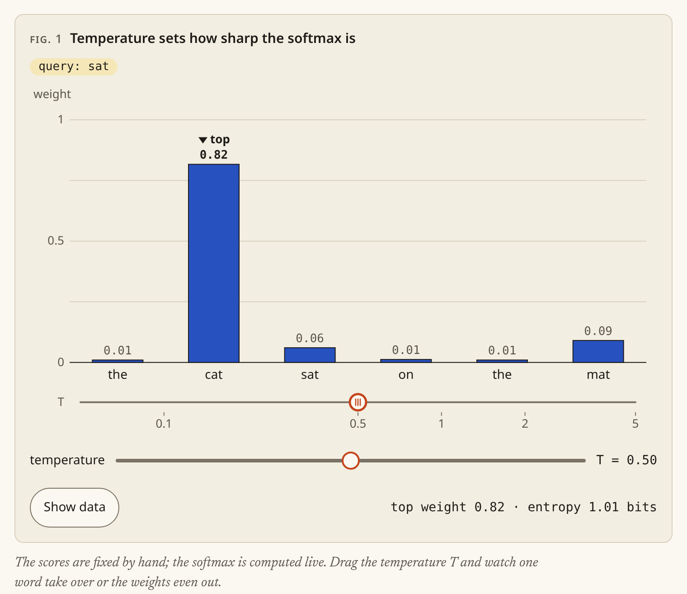
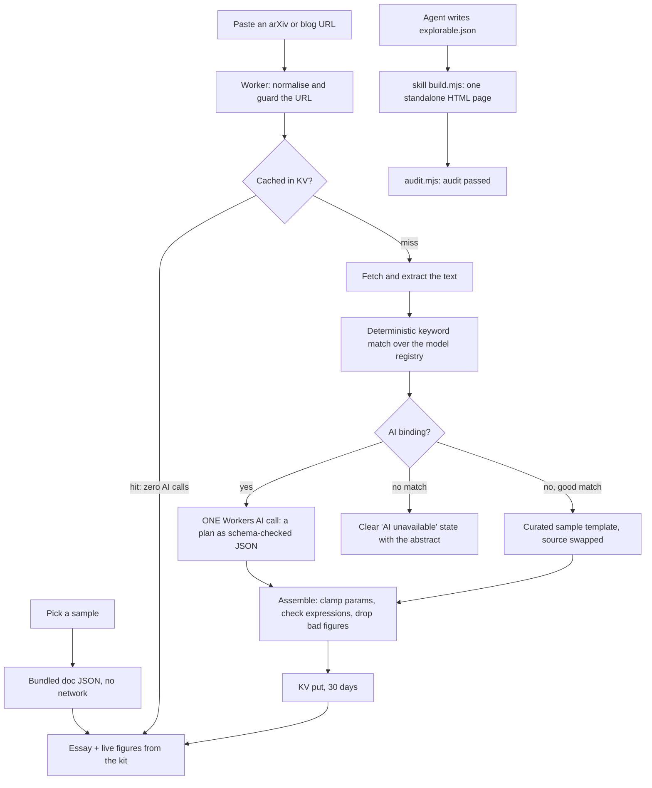

#  explorable

**Turn the core idea of a paper or post into a short essay with figures you can drag, and every number on them comes from a real, tested model.**



**Live demo: link coming soon.** &nbsp; Licence: MIT · Samples need no key and work offline · At most one AI call per new link · No tracking

## Quick start

**1. Try it in the browser.** Open the live demo (link above, coming soon), click *Why attention divides by √d* and drag the vermilion knob. No install, no account, no key.

**2. Run it locally.** You need [pnpm](https://pnpm.io) 9; pnpm fetches the pinned Node 22 itself.

```sh
git clone https://github.com/geekplux/explorable && cd explorable
pnpm i && pnpm dev
```

Open the URL Vite prints. The samples work offline. A pasted link works too: without an AI binding it reuses a matching sample or says plainly that AI is unavailable.

**3. Give your coding agent the skill.** One command installs the `/explorable` skill and builds an example page (Node 20.10+, nothing else):

```sh
npx degit geekplux/explorable/skills/explorable ~/.claude/skills/explorable && \
node ~/.claude/skills/explorable/scripts/build.mjs ~/.claude/skills/explorable/examples/bloom-filter/explorable.json
```

From a clone, copy it instead: `mkdir -p ~/.claude/skills && cp -r skills/explorable ~/.claude/skills/explorable`, then run the same `node …/build.mjs` line. Open `~/.claude/skills/explorable/examples/bloom-filter/index.html` and drag. Then in Claude Code ask `/explorable explain how a Bloom filter trades memory for false positives`. More in the [skill's README](skills/explorable/README.md).

## Why

You finish an abstract and feel you could follow it if you could poke at it. Bartosz Ciechanowski and Amelia Wattenberger showed how good that can be, but each of their essays takes weeks to build by hand. explorable gives you the same kind of page in seconds, for one idea at a time: a few short sections, two or three figures, and a knob on each that moves the parameter that matters. The figures are not screenshots or canned animations. Each one runs a small model of the idea, so what you see when you drag is what the maths says.

## How it works



**Only one AI call, and it never writes code that runs.** A new link costs at most one Workers AI call; a cached link, a sample or a match costs none. The model only *chooses*: the core idea, the prose, and which figures to show with which parameters, as JSON checked against a schema. Every figure on the page comes from the kit, a small library of tested figure kinds (`bars`, `bits`, `histogram`, `curve`) driven by registry models with hand-computed fixture tests. The one escape hatch, `expr-curve`, takes a formula in a tiny expression language that our own parser and evaluator check; there is no `eval`. A plan that fails validation loses the bad figures, and if none are left you get an error state, never a blank page.

Everything else is deterministic code: URL handling, extraction, search, the maths, rendering, validation and caching.

## Samples

All three ship with the app as data, open instantly and work offline. Each is also built as a standalone page in [examples/](examples/README.md). Until the live demo is up, download or clone the repository to open `examples/*.html`: GitHub shows their source, not the page.

| Sample | The idea | Source | Figures |
|---|---|---|---|
| [Why attention divides by √d](examples/attention.html) | Dot products of random vectors grow like √d and push a softmax into a spike; dividing by √d keeps attention soft. | [Attention Is All You Need](https://arxiv.org/abs/1706.03762) | softmax bars with a temperature knob; wider vectors with and without the √d_k scaling |
| [How a Bloom filter says "maybe"](examples/bloom-filter.html) | A Bloom filter can say "maybe" to a word it never saw, but never "no" to one it did. | [Bloom Filters by Example](https://llimllib.github.io/bloomfilter-tutorial/) | a row of bits you fill with words and query; false positives as the filter fills |
| [Noise, one step at a time](examples/diffusion.html) | The forward process blurs data into noise over 1,000 steps, and a closed form jumps to any step. | [Denoising Diffusion Probabilistic Models](https://arxiv.org/abs/2006.11239) | two clumps become one bell as you scrub the step t; how much signal is left at each step |

## Accessibility

Accessibility is part of done here, not polish:

- **Never colour alone.** One colour means "you can touch this", vermilion, and it always comes as the same hollow ring knob. Every data encoding is doubled by a shape, line style, glyph or direct label, and the palette is checked by unit tests under protanopia, deuteranopia and tritanopia.
- **Keyboard.** Every knob is a `role="slider"` with arrows, Page Up/Down and Home/End, plus a labelled native slider. Focus is always visible, and targets are at least 44 × 44 px.
- **Screen readers.** Every figure has alt text, a one-sentence live description (throttled so a drag never floods it) and a "Show data" table of the current values.
- **Reduced motion.** With `prefers-reduced-motion: reduce` there is no easing, no hint nudge and no idle motion.

The browser harness runs axe and these checks on every page. Found a gap? Please [open an issue](https://github.com/geekplux/explorable/issues/new/choose).

## Self-hosting

explorable is one Cloudflare Worker with static assets and a KV cache.

- **Without AI** (free, no keys): leave out the AI binding. The samples, search and keyword match mode all work, and an unmatched link shows the extracted title and abstract with a clear "AI unavailable" note.
- **With AI**: add a Workers AI binding and a KV namespace. Each new link costs one call, cached for 30 days; uncached requests are rate-limited.

The step-by-step guide is in [docs/DEPLOY.md](docs/DEPLOY.md). Local development never needs a login or a key.

## Roadmap

- A dark theme, with the palette re-checked for colour-vision deficiency.
- More figure kinds (scatter, grid, timeline) and more registry models.
- Share links that capture a figure's state, so "look at it with T = 0.2" is one URL.
- More built-in samples.
- Translations (i18n) for the app and the samples.

## Contributing

Contributions are welcome: models, figure kinds, samples, fixes, docs and translations. Start with [CONTRIBUTING.md](CONTRIBUTING.md), pick something from [docs/GOOD_FIRST_ISSUES.md](docs/GOOD_FIRST_ISSUES.md), and see [docs/EXTENDING.md](docs/EXTENDING.md) to add a model or a figure kind. Please follow the [Code of Conduct](CODE_OF_CONDUCT.md); report security problems as [SECURITY.md](SECURITY.md) describes. Changes are listed in [CHANGELOG.md](CHANGELOG.md).

## Licence

[MIT](LICENSE). The bundled fonts are under the SIL Open Font License ([public/fonts/OFL.txt](public/fonts/OFL.txt)).
