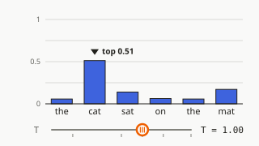
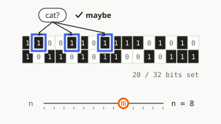
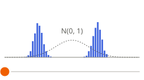

# Examples gallery

Every page here is a single HTML file with the kit, the font and the doc inlined. It opens from `file://`, makes no network request, and every number on it comes from a live model. Clone the repo and open any of them in a browser; there is nothing to install.

## Built-in samples

The three samples the app ships with, built through the skill's page builder.

| Example | Still | Source | Spec |
|---|---|---|---|
| [Why attention divides by √d](attention.html) |  | [Attention Is All You Need](https://arxiv.org/abs/1706.03762) | [src/samples/attention.json](../src/samples/attention.json) |
| [How a Bloom filter says "maybe"](bloom-filter.html) |  | [Bloom Filters by Example](https://llimllib.github.io/bloomfilter-tutorial/) | [src/samples/bloom-filter.json](../src/samples/bloom-filter.json) |
| [Noise, one step at a time](diffusion.html) |  | [Denoising Diffusion Probabilistic Models](https://arxiv.org/abs/2006.11239) | [src/samples/diffusion.json](../src/samples/diffusion.json) |

Rebuild all three (deterministic: the same specs and kit give the same bytes) and audit them:

```sh
pnpm build:examples
for page in examples/*.html; do node skills/explorable/scripts/audit.mjs "$page"; done
```

## Skill examples

The two worked examples that ship with the `/explorable` skill. They are the specs an agent copies from.

| Example | What it shows | Source | Spec |
|---|---|---|---|
| [How a Bloom filter says "maybe"](../skills/explorable/examples/bloom-filter/index.html) | a registry model (`bloom-filter`) with `bits` and `curve` figures, four math notes and a source note | [Bloom Filters by Example](https://llimllib.github.io/bloomfilter-tutorial/) | [explorable.json](../skills/explorable/examples/bloom-filter/explorable.json) |
| [Why coffee cools fast, then slowly](../skills/explorable/examples/newton-cooling/index.html) | `expr-curve`: a curve with knobs, a half-life marker and three math notes | Newton's law of cooling (a concept, no source page) | [explorable.json](../skills/explorable/examples/newton-cooling/explorable.json) |

Rebuild and audit one:

```sh
node skills/explorable/scripts/build.mjs skills/explorable/examples/newton-cooling/explorable.json
node skills/explorable/scripts/audit.mjs skills/explorable/examples/newton-cooling/index.html
```

After any change to the kit, run `pnpm build:kit`, then rebuild both sets and commit the pages: CI rebuilds them and fails if the committed ones are stale. See [CONTRIBUTING.md](../CONTRIBUTING.md).
